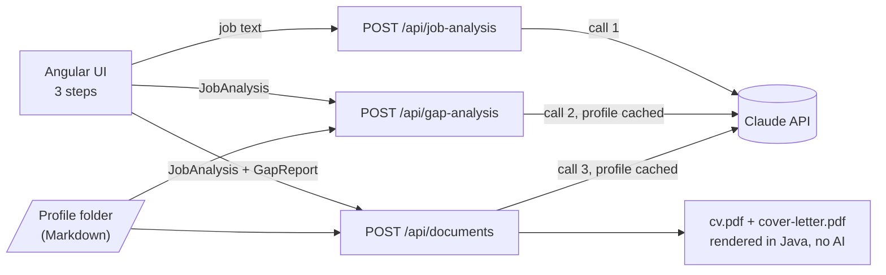

# cv-tailor

Paste a job post and get a CV and cover letter tailored to it, written only from evidence in your own profile.

cv-tailor is a small full-stack app built on the Claude API, with an Angular frontend and a Spring Boot backend. It works in three steps, and you review each one before the next:

1. **Job analysis:** Claude extracts the job's title, company, seniority, must-have and nice-to-have requirements, and keywords.
2. **Gap analysis:** each requirement is matched against your profile as **strong**, **partial** or **gap**. Every match cites the profile lines it's based on.
3. **Tailored documents:** a CV and a cover letter, shown as a preview and downloaded as two ATS-friendly PDFs.

It runs locally and needs no API key to try: without one, it runs in **demo mode** with canned answers written for a fictional profile.

<!-- Screenshot of the three steps: to be added once it can show real Claude output. -->

## No invented claims

A tailored CV is only useful if every line is true, so the app doesn't let Claude decide what's true:

- **Every claim cites evidence.** The profile is sent to Claude as lines tagged with ids such as `[exp-lumenledger-3]` or `[skill-angular]`. Each gap-analysis match and each CV sentence must list the ids it's based on.
- **The ids are checked in code.** If a gap-analysis match cites an id that doesn't exist, or cites nothing, it becomes a gap with a `Guardrail:` note. A CV sentence that cites an unknown id, or nothing at all, is dropped.
- **Facts come from the profile.** Claude writes only the summary, the bullets and the letter text. Names, job titles, companies, dates, project names, contact details, certificates and education are copied into the documents by code. Your contact details are never sent to Claude.
- **Skills you don't have stay out.** The profile can list skills with no evidence ("not evidenced"). They're shown to Claude as things never to claim, and they have no ids, so they can't be cited.
- **The cover letter has a word limit.** Letters over 250 words are flagged.

In demo mode, the canned gap analysis cites one invented id on purpose, so you can watch the guardrail turn that match into a gap.

## How it works



| Layer | Choice |
| :--- | :--- |
| Frontend | Angular 22 (standalone, zoneless, Signals), Tailwind CSS 4, Vitest |
| Backend | Java 25, Spring Boot 4, Gradle, JUnit 5 + Mockito |
| AI | [Anthropic Java SDK](https://github.com/anthropics/anthropic-sdk-java), model `claude-opus-5-5` |
| PDF | Thymeleaf HTML templates rendered with OpenHTMLtoPDF: tagged PDF/UA, embedded Noto Sans fonts, one column, no tables or icons |

### Claude features used, and why

- **Structured outputs.** Every response is parsed into a typed Java record (`JobAnalysis`, `GapReport`, the documents draft). The JSON schema comes from the record itself, so the API can't return a shape the code doesn't expect. The field descriptions in the schema double as part of the prompt.
- **Prompt caching.** Steps 2 and 3 both send the whole profile. It's the first block of the system prompt and is marked for caching, so the second call and any re-run read it from the cache instead of paying for it again. The profile text is rendered deterministically so the cache keeps hitting.

The app checks each response's stop reason before reading it, and a failed call reaches the UI as an error message instead of a half-written document.

## Run it locally

You need **JDK 25** and **Node.js 24**. The backend runs on port 8080, and the Angular dev server forwards `/api` to it.

```bash
# Terminal 1: backend
cd apps/api
./gradlew bootRun

# Terminal 2: frontend
cd apps/web
npm install
npm start          # http://localhost:4200
```

Paste a post from [docs/sample-jobs](docs/sample-jobs/) to try it.

### Demo mode (no API key)

When `ANTHROPIC_API_KEY` isn't set, the backend doesn't call Claude. Each step returns a hand-written answer from [fake-claude/](apps/api/src/main/resources/fake-claude/), written for the fictional profile in [demo-profile/](demo-profile/). The UI shows a "Demo mode" banner, and the answers stay the same whatever you paste. Everything else is real: the guardrail, the PDF rendering and the UI.

### With an API key

Set the key in the backend's environment, never in the frontend or a committed file:

```bash
export ANTHROPIC_API_KEY=sk-ant-...
cd apps/api && ./gradlew bootRun
```

### Settings

| Environment variable | Default | Meaning |
| :--- | :--- | :--- |
| `ANTHROPIC_API_KEY` | unset (demo mode) | Claude API key, read by the backend only |
| `PROFILE_DIR` | `../../demo-profile` | The profile folder to read. Relative paths start from `apps/api` |
| `OUTPUT_DIR` | unset | If set, the PDFs are also saved to `<OUTPUT_DIR>/<date>-<company>-<role>/`. If unset, they're only downloaded |

## Your profile

The profile is a folder of Markdown files: one file per employer, a project registry, a skills matrix with evidence, certificates, education, and a `contacts.yaml`. [demo-profile/](demo-profile/) shows the layout with a fictional person, Alex Doe.

To use your own profile, keep it in a separate private folder or repo, outside this one, and point `PROFILE_DIR` at it. Your data then never enters this repo, and the only thing that leaves your machine is the request to the Claude API.

## Tests

```bash
cd apps/api && ./gradlew build              # backend tests
cd apps/web && npx ng test --watch=false    # frontend tests
```

Tests never call the Claude API: it's mocked in unit tests, and the end-to-end tests run in demo mode. Schema tests build the real structured-output requests, so a record the API can't use fails the build even without a key.

## License

[MIT](LICENSE)
